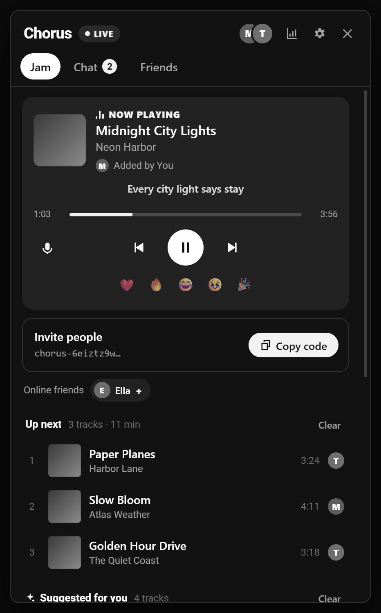
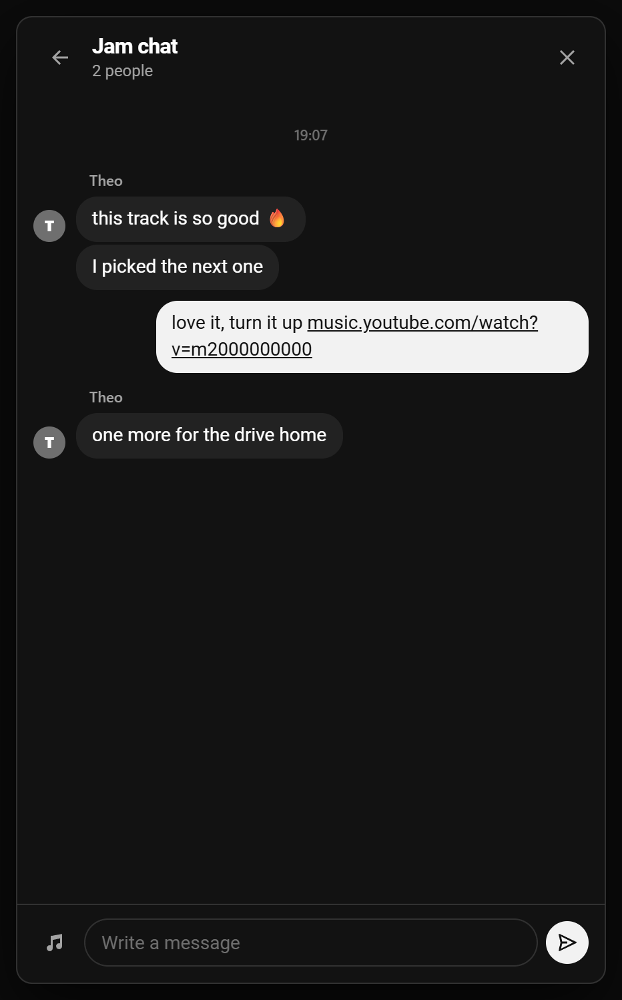
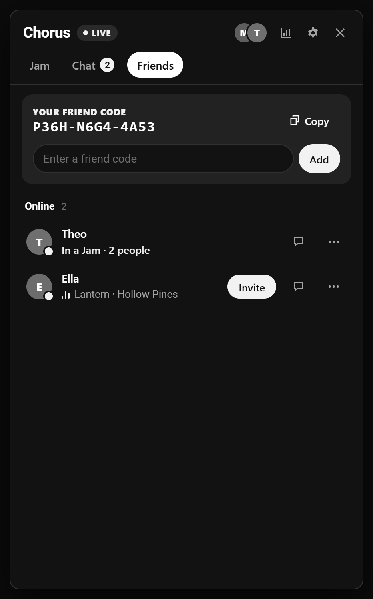

  

<h1 align="center">Chorus for YouTube Music</h1>

  YouTube Music'i arkadaşlarınla aynı anda, tam senkron dinle. 
  Ortak sıra · host yetkileri · uçtan uca şifreli sohbet · senkron şarkı sözleri · yıllık özet

  <a href="README.md">English</a> ·
  <a href="#kurulum">Kurulum</a> ·
  <a href="#nasıl-çalışır">Nasıl çalışır</a> ·
  <a href="PRIVACY.md">Gizlilik</a> ·
  <a href="SECURITY.md">Güvenlik</a>

  
  
  

## Özellikler

**Birlikte dinle**
- **Jam.** Bir Jam başlat ve davet kodunu paylaş. Herkes aynı şarkıyı aynı anda dinler. Saat senkronu ve hafif hız düzeltmesi sayesinde fark birkaç on milisaniyenin altında kalır.
- **Ortak sıra.** YouTube Music'teki herhangi bir `⋮` menüsünden şarkı, albüm ya da çalma listesi ekleyebilir veya şarkıya sağ tıklayabilirsin. Sırayı sürükleyerek düzenlersin. Sıra azalınca YouTube Music'in kendi radyosundan gelen öneriler devreye girer.
- **Host yetkileri.** Diğerlerinin neler yapabileceğine host karar verir. Varsayılanda misafirler şarkı ekleyebilir, çalmayı ise yalnızca host yönetir. Host her kişiye ayrı ayrı **Sıra** ya da **Kontrol** yetkisi verebilir. Ayrıca kişileri çıkarabilir, hostluğu devredebilir, Jam'i kilitleyebilir ve yeni davet kodu oluşturabilir. **Kontrol** yetkisi olan herkes senin sekmende istediği videoyu açabilir ve bu video YouTube geçmişinde görünür.
- **Reklamlarla uyumlu.** Ücretsiz sürümde reklam yalnızca seni bekletir, Jam'i değil. Reklam bitince Chorus seni doğru saniyeye geri getirir.
- **Tepkiler.** Çalan şarkıya ❤️ 🔥 😂 🥹 🎉 gönderebilirsin.

**Arkadaşlar ve sohbet**
- **Arkadaş kodu.** Herkesin `K7QM-2XPA-9RTV` gibi kısa bir kodu vardır. Arkadaşını bu kodla ya da doğrudan Jam'den ekleyebilirsin. Aynı ağda olmanız gerekmez.
- **Durum.** Hangi arkadaşının çevrimiçi olduğunu, ne dinlediğini ve kimin Jam'de olduğunu görürsün. Tek tıkla katılabilir ya da onları kendi Jam'ine çağırabilirsin.
- **Mesajlar.** Jam'deki herkesle ya da arkadaşlarınla birebir yazışabilirsin. Tüm mesajlar uçtan uca şifrelidir.

**Jam dışında da senin için**
- **Senkron sözler.** Sözler şarkıyla birlikte satır satır akar. Bir satıra tıklayınca şarkı oraya sarar. Kaynak: [LRCLIB](https://lrclib.net).
- **İstatistikler.** Son 30 gün, bu yıl ve tüm zamanlar için en çok dinlediğin şarkıları ve sanatçıları, toplam dakikanı ve hangi saatlerde dinlediğini görürsün. Veriler yalnızca senin cihazında saklanır. İstersen arkadaşlarına bir özet açabilirsin.
- **Yıllık özet.** Yıl bitince dakikaların, en çok dinlediğin sanatçı ve şarkılarla hazırlanan özetin açılıp paylaşılmaya hazır olur.
- **Uyku zamanlayıcısı.** Müzik 15, 30 ya da 60 dakika sonra veya şarkı bitince durur.
- **Türkçe ve İngilizce.** Chorus tarayıcının dilini kullanır. Dili Ayarlar'dan değiştirebilirsin.

Google hesabıyla giriş gerekmez. Chorus Google hesabını hiç okumaz; görünen adını Ayarlar'dan sen seçersin.

## Kurulum

Chorus; Chrome, Edge, Brave, Opera ve diğer Chromium tabanlı tarayıcılarda (sürüm 116 ve üzeri) çalışır.

1. [Releases](../../releases) sayfasından en yeni `chorus-ytm-*.zip` dosyasını indirip zipten çıkar. İstersen bu repoyu klonlayabilirsin.
2. `chrome://extensions` adresini aç (Edge'de `edge://extensions`) ve **Geliştirici modu**'nu aç.
3. **Paketlenmemiş öğe yükle**'ye bas ve `extension` klasörünü seç.
4. [music.youtube.com](https://music.youtube.com)'u aç ya da yenile. Chorus ve söz düğmeleri çalma çubuğunda, **Jam** düğmesi üst çubukta görünür.

Birlikte dinlemek isteyen herkesin Chorus'u kurması gerekir. Bu sürüm yalnızca diğer Chorus for YouTube Music kullanıcılarıyla konuşur, [Chorus for SoundCloud](https://github.com/bariswha/chorus-for-soundcloud) ile karışmaz.

## Nasıl çalışır

Chorus'un kendine ait bir sunucusu yoktur. Kullanıcılar küçük şifreli mesajlarını herkese açık MQTT aracıları üzerinden TLS WebSocket ile iletir. Ana aracı `broker.emqx.io`, yedekleri `broker.hivemq.com` ve `test.mosquitto.org`'dur.

- **Kimlik:** Her kurulum biri imza, biri anahtar değişimi için iki P‑256 anahtarı üretir. Kimliğin bu anahtarların özetidir, bu yüzden başkası senin kimliğine bürünemez.
- **Jam trafiği:** Davet kodundan türetilen anahtarla AES‑256‑GCM ile şifrelenir. Her mesaj ayrıca imzalanır, böylece kimse host'un ya da başka bir üyenin yerine geçemez.
- **Birebir mesajlar, davetler ve arkadaşlık istekleri:** Alıcıya özel, tek kullanımlık ECDH anahtarıyla şifrelenir ve gönderen tarafından imzalanır. Tekrar saldırılarına karşı her mesaj bir nonce ve zaman damgası taşır.
- **Durum bilgisi:** Yalnızca arkadaşlarının bildiği bir anahtarla şifrelenir ve sahibi tarafından imzalanır. Birini arkadaşlıktan çıkarınca bu anahtar yenilenir.
- **Jam'den çıkarma:** Biri Jam'den çıkarıldığında host Jam anahtarını yeniler ve eski davet kodu çalışmaz hale gelir.

Aracı sunucular yalnızca şifreli veriyi, rastgele görünen konu adlarını ve bağlantı IP'lerini görür. Ayrıntılar [SECURITY.md](SECURITY.md) dosyasında.

Sayfada Chorus, YouTube Music'in kendi oynatıcısını yönetir: Jam'in şarkısını YouTube Music'in normal gezinmesiyle açar, sarar, duraklatır ve senkronda kalmak için çalma hızını yüzde birkaç oynatır. Reklamlar normal şekilde oynar; reklam sürerken Chorus bekler, sonra yeniden senkronlar. Şarkı bilgileri ve öneriler YouTube Music'in herkese açık `next` uç noktasından, çerez gönderilmeden alınır.

## Uyumluluk

Chorus, YouTube Music'in web oynatıcısına bağlanır ve bu oynatıcı haber vermeden değişebilir. Reklamları asla atlamaz ya da engellemez. Bir YouTube Music güncellemesinden sonra bir şey bozulursa lütfen issue aç.

## Destek

Chorus ücretsiz ve öyle kalacak; kendi reklamı ya da takibi yok. İşine yaradıysa [GitHub Sponsors](https://github.com/sponsors/bariswha) üzerinden destek olabilirsin. Gelen destek geçimimi sağlamama yardımcı oluyor, böylece daha fazla ücretsiz eklenti geliştirip yayınlamaya devam edebiliyorum.

## Bilmen gerekenler

- **Hassas bilgi için değil.** Mesajlar uçtan uca şifreli, ama Chorus birlikte müzik dinlemek için yapıldı, özel yazışmalar için değil. Şifre, kişisel belge ya da hassas bir bilgi paylaşma.
- **Davet kodu bir anahtardır.** Bir Jam'in davet koduna sahip olan herkes Jam'e katılabilir ve sohbetini okuyabilir. Kodu yalnızca güvendiğin kişilerle paylaş; sızarsa **Yeni davet kodu** oluştur.
- **Profesyonel denetimden geçmedi.** Kod incelendi ve test edildi, ama bir güvenlik firması tarafından denetlenmedi. İleriye dönük gizlilik (forward secrecy) yok: bir anahtar ileride ele geçirilirse daha önce kaydedilmiş trafik çözülebilir. Ayrıntılar [SECURITY.md](SECURITY.md) dosyasında.
- **Ses paylaşılmaz.** Chorus ses dosyası indirmez, kaydetmez ya da dağıtmaz. Her dinleyici şarkıyı kendi YouTube Music sekmesinde çalar; YouTube Music kullanımın YouTube'un kendi koşullarına tabidir.
- **Olduğu gibi sunulur.** Chorus ücretsiz bir hobi projesidir ve hiçbir garanti vermez. Ayrıntılar [LICENSE](LICENSE) dosyasında.

## Sorumluluk reddi

Chorus bağımsız, açık kaynaklı bir projedir. YouTube ya da Google ile bir bağı yoktur ve onlar tarafından onaylanmamış ya da desteklenmemiştir. YouTube Music, Google LLC'nin ticari markasıdır.

## Lisans

[MIT](LICENSE)
